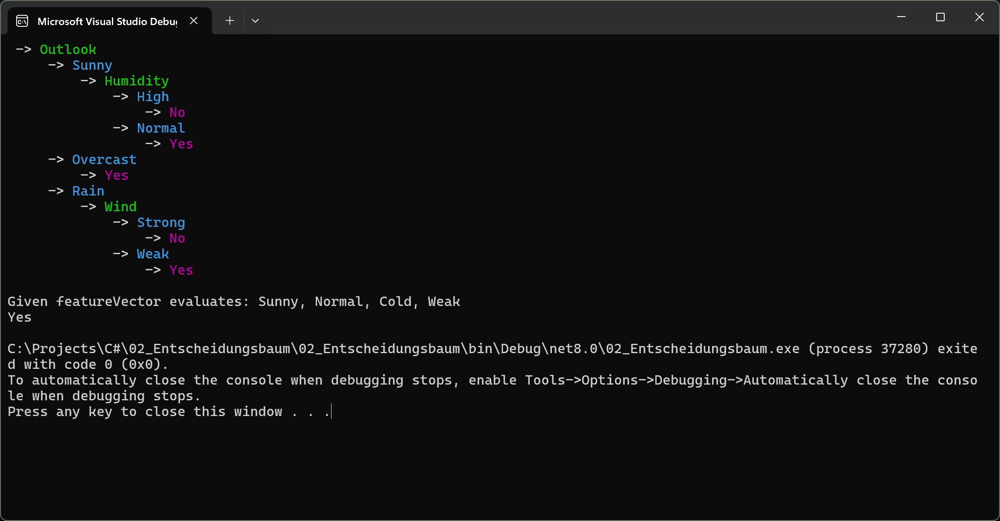
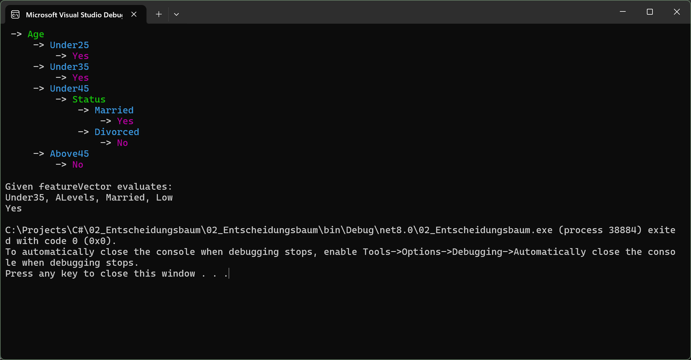

# Decision Tree – Gini Impurity

A C# project that implements a decision tree to make predictions based on given data.

## What Does It Do?

A decision tree makes decisions by checking different conditions step by step. Based on these conditions, it predicts a result.

This project includes two datasets:

- **Tennis:** Predicts whether someone should play tennis based on weather conditions such as outlook, temperature, humidity, and wind.
- **Credit Approval:** Predicts whether someone gets a credit based on information such as age, education, marital status, and income.

## How It Works

The algorithm uses **Gini Impurity** to find the most useful feature for each decision. It builds a tree recursively until it can assign a prediction to each branch.

You can also provide new data to the trained tree and let it predict the result.

## Screenshots

### Tennis Dataset

### Credit Approval Dataset

## Technologies

- C#
- .NET
- Recursive algorithms
- Generic types and enums
- Gini Impurity

## How to Run

Open the project in Visual Studio and run the console application.

## Author

Irene Hofer